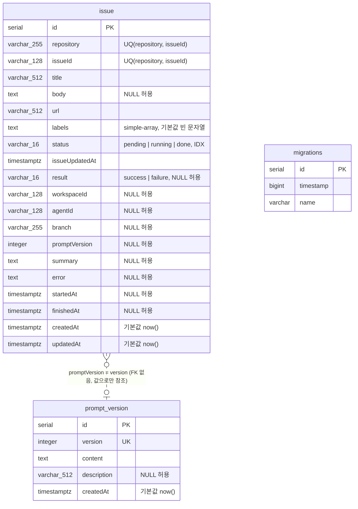

# DATA ARCHITECTURE — Data 모듈 요구사항 (DAT-001, DAT-002)

- 작성: 2026-10-12 13:13

## 1. 개요

저장소는 PostgreSQL 하나다. 업무 테이블 `issue`(이슈 큐이자 처리 이력)와 `prompt_version`(프롬프트 이력)의 **모델은 바꾸지 않는다.** 이번 작업이 더하는 것은 두 가지다.

- 스키마를 만드는 두 번째 경로: 저장소에 포함된 마이그레이션(`app/src/db/migrations/`).
- migration 방식에서 TypeORM이 관리하는 적용 이력 테이블 `migrations`. synchronize 방식만 쓰는 DB에는 만들어지지 않는다.

## 2. 데이터 모델



| 엔티티 | 필드 | 타입 | 제약 | 설명 |
|---|---|---|---|---|
| `issue` | `id` | serial | PK `PK_f80e086c249b9f3f3ff2fd321b7` | 큐 순서의 기준(`id` 오름차순으로 처리) |
| | `repository`, `issueId` | varchar(255), varchar(128) | NOT NULL, unique `UQ_issue_repo_issue_id` | 소스 기준 자연키. 중복 적재를 막는 최종 방어선 |
| | `title`, `url` | varchar(512) | NOT NULL | 수집 시점의 이슈 정보 |
| | `body` | text | NULL 허용 | 이슈 본문 |
| | `labels` | text | NOT NULL, 기본값 `''` | TypeORM `simple-array`(쉼표로 이은 문자열) |
| | `status` | varchar(16) | NOT NULL, 기본값 `pending`, index `IDX_issue_status` | `pending`/`running`은 큐, `done`은 이력 |
| | `issueUpdatedAt` | timestamptz | NOT NULL | 소스 기준 최종 갱신 시각 |
| | `result` | varchar(16) | NULL 허용 | `done`의 성패(`success`/`failure`) |
| | `workspaceId`, `agentId` | varchar(128) | NULL 허용 | 처리에 쓴 Paseo workspace·에이전트 |
| | `branch` | varchar(255) | NULL 허용 | 이슈 브랜치 |
| | `promptVersion` | integer | NULL 허용 | 처리에 쓴 프롬프트 버전 |
| | `summary`, `error` | text | NULL 허용 | 에이전트 마지막 메시지, 실패 사유 |
| | `startedAt`, `finishedAt` | timestamptz | NULL 허용 | 선점 시각, 처리 종료 시각 |
| | `createdAt`, `updatedAt` | timestamptz | NOT NULL, 기본값 `now()` | 적재 시각, 마지막 갱신 시각(TypeORM이 갱신) |
| `prompt_version` | `id` | serial | PK `PK_cb9ff9b4ab70babd62914aa97a5` | |
| | `version` | integer | NOT NULL, unique `UQ_1c4aebce69bf91205bcd40f50be`, index `IDX_prompt_version_version` | 가장 큰 값이 최신 |
| | `content` | text | NOT NULL | 프롬프트 템플릿 |
| | `description` | varchar(512) | NULL 허용 | |
| | `createdAt` | timestamptz | NOT NULL, 기본값 `now()` | |
| `migrations` | `id`, `timestamp`, `name` | serial, bigint, varchar | PK(`id`) | TypeORM이 만들고 관리한다. 적용한 마이그레이션마다 1행. 앱 코드는 직접 읽거나 쓰지 않는다 |

`issue`·`prompt_version`은 모두 **변경 없음**이다. 제약·인덱스 이름은 현재 엔티티로 synchronize했을 때 TypeORM이 만드는 이름 그대로다.

## 3. 데이터 수명주기

**`issue` (큐와 이력 — DAT-001, 변경 없음)**

| 시점 | 주체 | 동작 |
|---|---|---|
| 수집 | `IssueCollector` | 같은 `(repository, issueId)` 행이 없으면 `status = pending`으로 INSERT. 이력 컬럼은 NULL |
| 선점 | `IssueWorker` | `UPDATE ... WHERE id = ? AND status = 'pending'` → `running`, `startedAt` 기록 |
| 완료 | `IssueWorker` | 같은 행을 `status = done`, `result`, `workspaceId`, `agentId`, `branch`, `promptVersion`, `summary`, `error`, `finishedAt`으로 UPDATE |
| 취소·프롬프트 없음 | `IssueWorker` | `status = pending`으로 되돌림(이력이 아니다) |
| 삭제 | 없음 | 데몬은 행을 지우지 않는다. `done` 행이 이력이자 중복 적재 방지 기준이다 |

큐와 이력은 프로세스 메모리에 두지 않는다. 재기동한 프로세스는 `pending` 행을 다시 읽어 이어서 처리하고, `done` 행은 그대로 남는다(AC-03).

**`prompt_version`**: 운영자가 SQL로 INSERT한다. 데몬은 읽기만 한다(변경 없음).

**`migrations`**: migration 방식으로 처음 기동할 때 TypeORM이 만들고, 마이그레이션을 적용할 때마다 1행을 INSERT한다. 데몬은 행을 지우지 않는다.

## 4. 마이그레이션

### 4.1 스키마 관리 방식

| | synchronize 방식 (`DB_SYNCHRONIZE=true`, 기본값) | migration 방식 (`DB_SYNCHRONIZE=false`) |
|---|---|---|
| 스키마의 기준 | 엔티티 정의 | 저장소의 마이그레이션 |
| 기동 시 동작 | 엔티티와 현재 스키마를 비교해 DDL 실행. 엔티티에 없는 컬럼은 **삭제**한다 | 미적용 마이그레이션만 순서대로 적용. 그 밖의 스키마는 건드리지 않는다 |
| `migrations` 테이블 | 만들지도 쓰지도 않는다 | 없으면 만들고, 적용한 마이그레이션을 기록한다 |
| 알맞은 곳 | 개발, 처음 써 보는 환경 | 데이터를 보존해야 하는 운영 |

### 4.2 초기 마이그레이션 `InitialSchema1791802800000`

- 파일: `app/src/db/migrations/1791802800000-InitialSchema.ts`. 클래스 이름 끝의 13자리가 적용 순서를 정하는 타임스탬프다(2026-10-12 11:00:00 UTC).
- `up`: 현재 엔티티로 synchronize했을 때 TypeORM 스키마 빌더가 빈 DB에 내는 DDL(2026-10-12, TypeORM 1.1.1, PostgreSQL 18.4에서 추출)에 `IF NOT EXISTS`만 더한 것이다.
  ```sql
  CREATE TABLE IF NOT EXISTS "issue" ("id" SERIAL NOT NULL, "repository" character varying(255) NOT NULL, "issueId" character varying(128) NOT NULL, "title" character varying(512) NOT NULL, "body" text, "url" character varying(512) NOT NULL, "labels" text NOT NULL DEFAULT '', "status" character varying(16) NOT NULL DEFAULT 'pending', "issueUpdatedAt" TIMESTAMP WITH TIME ZONE NOT NULL, "result" character varying(16), "workspaceId" character varying(128), "agentId" character varying(128), "branch" character varying(255), "promptVersion" integer, "summary" text, "error" text, "startedAt" TIMESTAMP WITH TIME ZONE, "finishedAt" TIMESTAMP WITH TIME ZONE, "createdAt" TIMESTAMP WITH TIME ZONE NOT NULL DEFAULT now(), "updatedAt" TIMESTAMP WITH TIME ZONE NOT NULL DEFAULT now(), CONSTRAINT "UQ_issue_repo_issue_id" UNIQUE ("repository", "issueId"), CONSTRAINT "PK_f80e086c249b9f3f3ff2fd321b7" PRIMARY KEY ("id"));
  CREATE INDEX IF NOT EXISTS "IDX_issue_status" ON "issue" ("status");
  CREATE TABLE IF NOT EXISTS "prompt_version" ("id" SERIAL NOT NULL, "version" integer NOT NULL, "content" text NOT NULL, "description" character varying(512), "createdAt" TIMESTAMP WITH TIME ZONE NOT NULL DEFAULT now(), CONSTRAINT "UQ_1c4aebce69bf91205bcd40f50be" UNIQUE ("version"), CONSTRAINT "PK_cb9ff9b4ab70babd62914aa97a5" PRIMARY KEY ("id"));
  CREATE INDEX IF NOT EXISTS "IDX_prompt_version_version" ON "prompt_version" ("version");
  ```
- `down`: 두 인덱스와 두 테이블을 `DROP ... IF EXISTS`로 지운다. TypeORM의 `MigrationInterface`가 요구해서 두는 것이며, 데몬은 되돌리기를 실행하지 않는다(범위 제외).

### 4.3 기존 데이터 처리

- **빈 DB**: 초기 마이그레이션이 두 테이블과 인덱스를 만든다. 결과 스키마는 synchronize가 만드는 것과 같다(AC-09).
- **synchronize로 만들어진 기존 DB**: `IF NOT EXISTS`가 이미 있는 테이블·인덱스를 건너뛰므로 DDL은 실행되지 않고, `migrations`에 적용 기록만 남는다. 기존 행과 스키마는 그대로다(AC-11).
- **예전 버전의 엔티티로 만들어진 뒤 현재 버전으로 동기화되지 않은 DB**: 테이블이 있으므로 건너뛴다. 스키마가 어긋난 채 남으므로, 전환 전에 현재 버전으로 한 번 `DB_SYNCHRONIZE=true` 기동을 해 스키마를 맞춘다(README 전환 절차).
- **migration → synchronize로 되돌리는 경우**: synchronize가 엔티티에 맞춘다. `migrations` 테이블은 엔티티가 아니므로 TypeORM이 건드리지 않고 남는다.

### 4.4 이후 마이그레이션을 추가하는 규칙

1. 엔티티를 고친다.
2. `app/src/db/migrations/<13자리 ms 타임스탬프>-<이름>.ts`에 `MigrationInterface` 구현 클래스를 만든다. 클래스 이름은 `<이름><타임스탬프>`이고 타임스탬프는 기존 것보다 커야 한다.
3. `migrations/index.ts`의 배열 끝에 등록한다.
4. `up`은 **현재 버전의 엔티티로 synchronize된 DB에 적용해도 실패하지 않고 스키마를 바꾸지 않게** 쓴다(`ADD COLUMN IF NOT EXISTS`, `DROP COLUMN IF EXISTS`, 존재 확인 후 실행 등). synchronize 방식으로 돌던 DB를 나중에 migration 방식으로 전환하면 그때까지의 마이그레이션이 한꺼번에 "미적용"으로 실행되기 때문이다.
5. 이미 배포된 마이그레이션의 내용은 고치지 않는다. 변경은 새 마이그레이션으로 한다.
6. 마이그레이션은 엔티티를 import하지 않는다(작성 시점의 스키마를 고정한다).

### 4.5 롤백

- 적용 중 실패: 미적용 마이그레이션 전체가 한 트랜잭션이라 그 변경과 이력 기록이 모두 롤백되고 데몬은 기동에 실패한다(exit 1). `migrations` 이력 테이블 자체는 TypeORM이 트랜잭션을 시작하기 전에 만들므로, 처음 migration 방식으로 기동하다 실패하면 빈 테이블(0행)로 남는다. 다음 기동은 이 테이블을 그대로 쓰고 같은 마이그레이션을 다시 시도한다.
- 적용이 끝난 마이그레이션의 되돌리기 명령은 제공하지 않는다(범위 제외). 필요하면 운영자가 DB 백업에서 복구하거나 되돌리는 마이그레이션을 새로 추가한다.

## 5. 정합성과 동시성

- **중복 적재 방지**: `UQ_issue_repo_issue_id`가 최종 방어선이다. 수집기는 존재 확인 후 `ON CONFLICT DO NOTHING`으로 넣는다(변경 없음).
- **선점**: `UPDATE ... WHERE status = 'pending'`의 영향 행 수로 한 번만 처리한다(변경 없음, WRK-001 범위).
- **이력 기록**: 이슈 한 건의 완료 기록은 단일 `UPDATE`다. 여러 문장에 걸친 트랜잭션이 없다(변경 없음).
- **스키마 준비**: 큐·이력 접근보다 먼저 끝난다(`initializeDataSource()`가 반환된 뒤에야 프롬프트 조회와 루프가 시작된다). migration 방식에서 마이그레이션의 실행과 이력 기록은 한 트랜잭션이다(이력 테이블 생성만 그 앞에서 따로 일어난다 — §4.5). 데몬은 단일 인스턴스로 운용하므로 여러 프로세스가 동시에 마이그레이션을 적용하는 경우는 다루지 않는다(범위 제외).
- **두 방식의 스키마 동등성**: 초기 마이그레이션의 DDL을 스키마 빌더 출력에서 가져와 보장한다. 엔티티를 바꾸면 같은 변경을 마이그레이션으로도 추가해야 동등성이 유지된다(§4.4).

## 6. 결정과 근거

| 결정 | 대안 | 선택과 근거 |
|---|---|---|
| 업무 테이블 모델 | (A) 변경 없음 (B) 큐와 이력을 다른 테이블로 분리 | **A**. `issue` 한 테이블이 이미 큐와 이력을 저장하고 인접 요구사항(ISS-008, WRK-003, WRK-005)이 이 모델 위에서 검증됐다. DAT-001은 "저장할 수 있다"만 요구한다 |
| 마이그레이션 이력 테이블 이름 | (A) TypeORM 기본값 `migrations` (B) `migrationsTableName`으로 별도 이름 | **A**. 설정을 늘리지 않고, TypeORM 문서·도구와 그대로 맞는다. 이 DB는 이 데몬 전용이라 이름 충돌이 없다 |
| 트랜잭션 모드 | (A) `all` (B) `each` (C) `none` | **A**(TypeORM 기본값). 일부만 적용된 상태로 남지 않는다 |
| 초기 마이그레이션의 멱등성 | SOFTWARE_ARCHITECTURE §2.6 | `IF NOT EXISTS` |
| DDL 형태 | SOFTWARE_ARCHITECTURE §2.7 | 스키마 빌더 출력을 옮긴 raw SQL |

## 변경 이력

| 일시 | Iteration | 변경 내용 | 이유 |
|---|---|---|---|
| 2026-10-12 13:34 | 2 | §4.5·§5에서 "실패 시 DB는 기동 전 상태"를 "마이그레이션의 변경과 이력 기록은 롤백되고 빈 `migrations` 테이블은 남을 수 있다"로 고쳤다. 데이터 모델과 마이그레이션 내용은 그대로다 | EVALUATION iteration 1 피드백 1(F-01). 이력 테이블 생성이 트랜잭션 밖에서 일어난다 |
| 2026-10-12 13:34 | 2 | 머리말 작성 시각을 13:18 → 13:13으로 정정 | EVALUATION iteration 1 피드백 2(F-08). 타임라인의 architecture 단계(13:10 ~ 13:14)와 맞춘다 |
