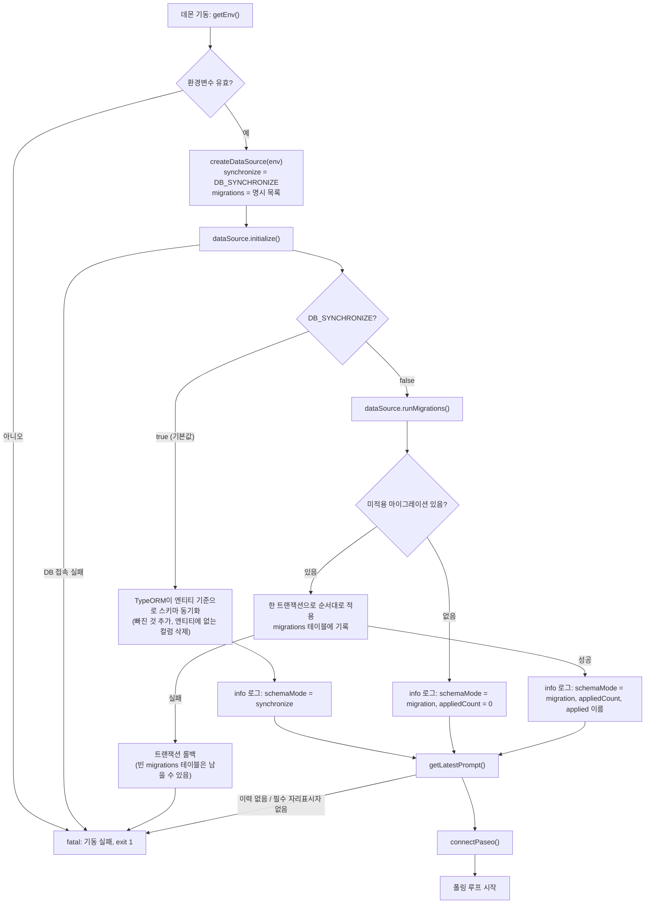
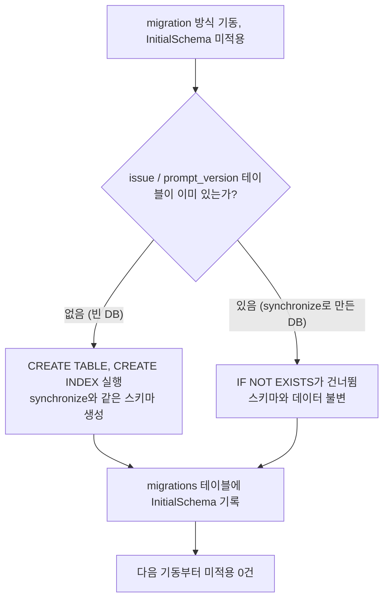
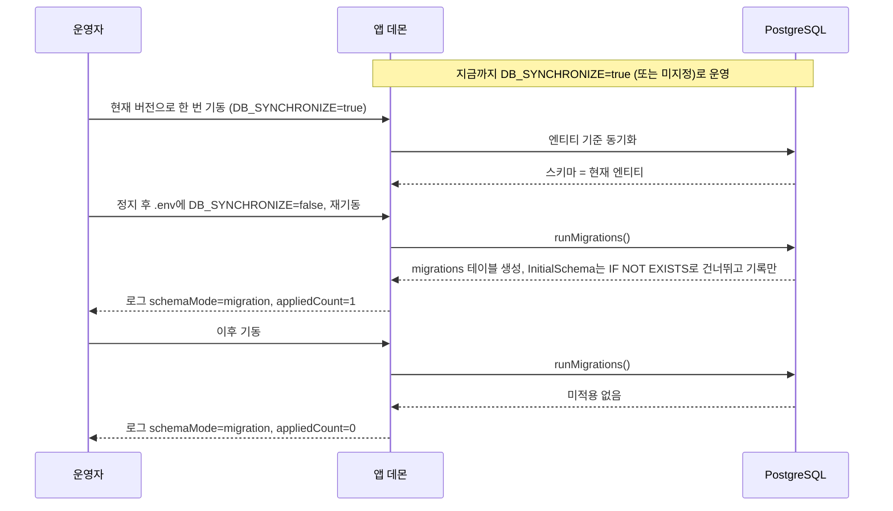
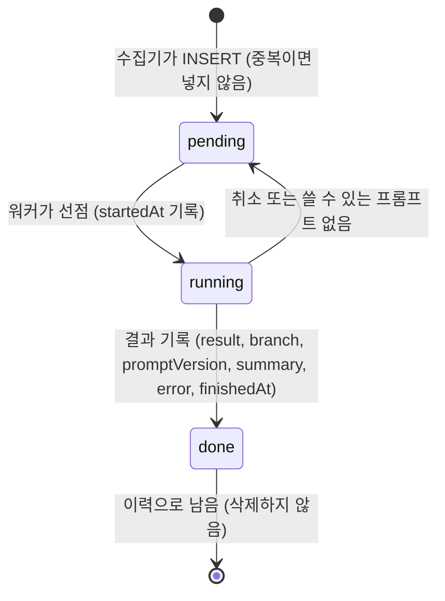

# FLOW CHART — Data 모듈 요구사항 (DAT-001, DAT-002)

- 작성: 2026-10-12 13:14

## 기동 시 스키마 준비 (DAT-002)

`initializeDataSource()`가 `DB_SYNCHRONIZE`에 따라 스키마를 맞춘 뒤에야 프롬프트 이력 검사와 Paseo 연결로 넘어간다. 스키마 준비에 실패하면 기동 실패다.



## 초기 마이그레이션이 DB 상태별로 하는 일

`InitialSchema`는 `IF NOT EXISTS`로 쓰여 있어 빈 DB와 synchronize로 만든 기존 DB 모두에서 실패하지 않는다.



## synchronize 방식에서 migration 방식으로 전환 (운영 절차)



## 이슈 행의 상태 (DAT-001, 변경 없음)

큐와 이력은 `issue` 테이블의 같은 행이다. 행은 지워지지 않고 `status`만 바뀐다.



## 큐 적재와 이력 기록 (DAT-001, 변경 없음)

```mermaid
sequenceDiagram
    participant Loop as 폴링 루프
    participant Col as IssueCollector
    participant W as IssueWorker
    participant R as AgentRunner
    participant DB as PostgreSQL (issue)

    Loop->>Col: collect()
    Col->>DB: 같은 (repository, issueId) 행이 있는가?
    DB-->>Col: 없음
    Col->>DB: INSERT status=pending ON CONFLICT DO NOTHING
    Loop->>W: drain()
    W->>DB: SELECT status=pending ORDER BY id
    W->>DB: UPDATE status=running WHERE status=pending
    W->>R: run(이슈, 렌더링한 프롬프트)
    R-->>W: AgentRunOutcome
    W->>DB: UPDATE status=done, result, 이력 컬럼
    Note over DB: 프로세스가 재기동해도 pending / done 행은 그대로 남는다
```

## 변경 이력

| 일시 | Iteration | 변경 내용 | 이유 |
|---|---|---|---|
| 2026-10-12 13:34 | 2 | "기동 시 스키마 준비" 흐름의 롤백 노드에 "빈 migrations 테이블은 남을 수 있음"을 더했다 | EVALUATION iteration 1 피드백 1(F-01). SOFTWARE_ARCHITECTURE §2.3 정정과 맞춘다 |
| 2026-10-12 13:34 | 2 | 머리말 작성 시각을 13:20 → 13:14로 정정 | EVALUATION iteration 1 피드백 2(F-08). 타임라인의 architecture 단계(13:10 ~ 13:14)와 맞춘다 |
